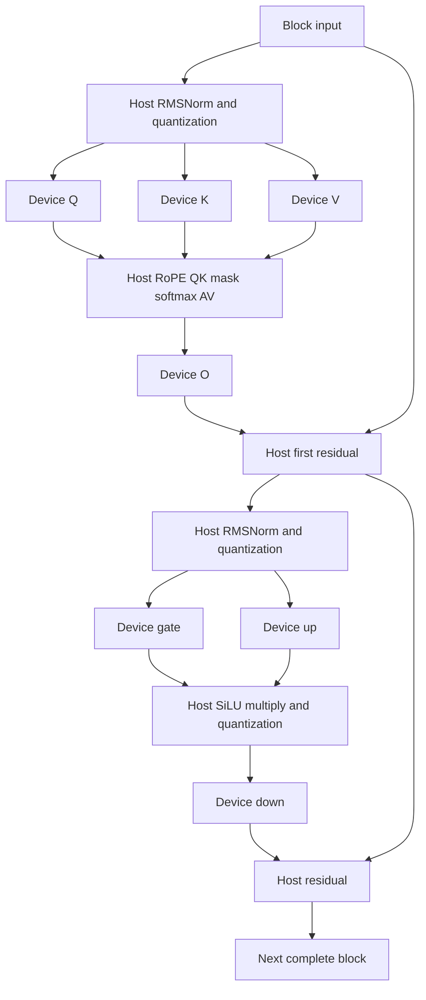

# Transformer compiler optimization for Gemmini

This branch extends the archived Merlin-generated Gemmini backend with optimizations across device-group boundaries and through scalar host lowering. The workload is a real sequence of complete Llama-style decoder blocks: normalization, causal attention, both residual paths, and the gated MLP. The compiler changes use SSA identity, types, layouts, operation semantics, allocation provenance, and target capabilities. They do not recognize a transformer name, a checkpoint, a seed, or one particular matrix shape.

The optimized implementation is in [`compiler_optimized/`](compiler_optimized/). The original [`compiler/`](compiler/) remains byte-identical to the archived submission: 1,251 files with source digest `4994f7b478047decf473e8263f6246b493f5189f0fbfef70b921ba8f99b012f7`. The original paper measurements under `experiment/` and the new local measurements under `walkthrough/` have separate provenance.

The final default measures **357,674 cycles for one complete block** and **1,060,118 cycles for three consecutive blocks** on the existing RTL image. Relative to the completed one-block-optimization checkpoint, those are reductions of **33.4%** and **35.3%**, or about **1.50×** and **1.55×** speedups. All 256 final output values are bit-exact to the corresponding quantized PyTorch references. The selected policy has four physical groups per block and uses full helper inlining at scalar `-O3`.

| Compiler milestone | One block cycles | Three blocks cycles |
|---|---:|---:|
| Frozen compiler through the same local `-O3` route | 636,290 | — |
| Source sharing and scalar fusion checkpoint | 537,032 | 1,639,267 |
| Bounded scalar rounding | 483,977 | 1,449,383 |
| Allocation provenance and call contracts, without static copies | 380,748 | — |
| Add static copies, ordinary native helper visibility | 362,214 | — |
| Add full helper inlining, separate groups | 358,988 | 1,067,468 |
| **Final default with shared-product groups** | **357,674** | **1,060,118** |

The final one-block default is also 43.8% below the frozen compiler on the same local `-O3` route. Dashes mean that milestone was not separately timed for that chain length. The `inline_adapters` alternative reaches 356,696 cycles for one block, but the full three-block objective selects `inline_all`. These are measured workload results, not a claim of optimality for every model or shape.

## Workload and numerical contract

The primary experiment uses batch 1, 8 tokens, model width 32, 2 attention heads of width 16, and MLP width 64. The chain contains three complete decoder blocks with distinct parameters. All 21 quantized projection weights are distinct; the first block and its input match the one-block baseline exactly. These are deterministic seed-117 demonstration weights, rather than a trained language-model checkpoint. Embedding, the final model-wide normalization, and the vocabulary projection are outside this workload.

The PyTorch model comes from the existing `model2MLIR/workloads/small_llama/loader.py`. The capture wrapper replaces each bias-free linear with an explicit W8A8 operation:

```text
A8 = int8(clamp(round_even(A_float * 32), -128, 127))
W8 = int8(clamp(round_even(W_float * 128), -128, 127))
C32 = A8 @ transpose(W8)                  # signed int8 × int8 → int32
Y_float = float32(C32) * (1 / 4096)
```

Weights are quantized before capture and supplied as ordinary externalized tensors. Activation quantization remains in the graph. RMSNorm, rotary position encoding, attention scores, softmax, attention-value multiplication, residual additions, and SiLU use the existing FP32 path on Rocket. Contraction and vectorization are disabled in native compilation; the experiments do not enable fast math or reassociate floating reductions.

Correctness means all final output bits agree with the **quantized PyTorch model**. It does not mean the quantized model reproduces the original all-float model: the recorded one-block maximum absolute difference between those models is about 0.0305. Every accepted RTL measurement checks all 256 final FP32 values, successful process exit, and normal Verilog harness completion. Nearby-shape functional checks compare all 240 values.

Sources: [one-block capture](walkthrough/transformer_layer/capture.py), [chain capture](walkthrough/three_block_optimization/capture.py), [capture metadata](walkthrough/three_block_optimization/capture/capture_summary.json), and [distinct-weight identity](walkthrough/three_block_optimization/chain_identity.json).

## What a device group means

A device group is an extracted region that the Gemmini backend can implement under its supported integer tensor semantics. It is not a whole attention module, a whole decoder block, or an arbitrary sequence of PyTorch operators. The source router proves region closure, chooses the device cut, and leaves the surrounding graph on the host.

Before clustering, one decoder block has seven logical projection groups:

| Logical group | Matrix dimensions M K N | Host work around the call |
|---|---|---|
| Q projection | 8 32 32 | First RMSNorm and shared activation quantization precede Q/K/V |
| K projection | 8 32 32 | Reuses the same quantized activation tensor as Q |
| V projection | 8 32 32 | Reuses the same quantized activation tensor as Q/K |
| O projection | 8 32 32 | RoPE, causal QK, softmax, AV, layout changes and quantization precede O |
| Gate projection | 8 32 64 | First residual, second RMSNorm and shared activation quantization precede gate/up |
| Up projection | 8 32 64 | Reuses the gate input tensor |
| Down projection | 8 64 32 | SiLU, gate-times-up and activation quantization precede down |

The unclustered three-block chain has 21 calls. Kernel-code reuse produces three distinct device kernel bodies for those shapes; code reuse does not make the weights or activations identical. The diagram shows logical dependencies; physical grouping is selected separately.



The second residual's bypass carries the first residual value, before its normalization. Source SSA retains that exact dependency.

The FP32 QK and AV products are not offloaded by this integer backend. Doing so would require a different numerical contract or target capability. Likewise, the O result, first residual, second norm, gate/up, and down form genuine dependencies. Sharing or scheduling around those boundaries is legal; removing the boundaries by equating their values is not.

A general pass can expose shared-input Q/K/V and gate/up contractions as four physical groups per block: `{Q,K,V}`, `{O}`, `{gate,up}`, `{down}`. The logical products remain distinct. This produces 12 physical calls across three blocks, with four distinct kernel bodies. Grouping and native inlining are benchmarked jointly; fewer calls alone do not establish a faster compiler.

## From PyTorch to the executable

| Stage and product | Owner | What happens |
|---|---|---|
| PyTorch module and reference outputs | Capture wrapper and model2MLIR | Instantiate complete blocks, replace linears with explicit integer products, export inputs, weights and reference outputs |
| `capture/model.mlir` | model2MLIR FXImporter | Decompose the exported graph into tensor, linalg, arith and math operations; reject opaque operations |
| `source-optimized.mlir` | `backend/source_cse.py` | Share equivalent immutable tensor preparation before device discovery |
| `routed.mlir`, `placement.json`, extracted group sources | [Source router](compiler_optimized/backend/source_groups.py) and [host adapter](compiler_optimized/backend/host_runtime.py) | Admit device regions, preserve host dataflow, establish tensor argument and result ABIs |
| Group logical command buffers | [Gemmini frontend](compiler_optimized/backend/frontend.py) | Recognize supported contractions, infer tensor storage and logical pointer bindings |
| Checked dense schedules and `device.mlir` | [Dense scheduling](compiler_optimized/backend/dense.py), [shared products](compiler_optimized/backend/shared_products.py) and [target dispatch](compiler_optimized/backend/compiler.py) | Select bounded tile geometry, storage residency, transfers, execution and readout epochs; verify mappings before emitting instructions |
| Host tensor, bufferized and loop IR | [Bundled Merlin stock transport](compiler_optimized/compiler_library/merlin/llvmlower/stock_cli.py) plus upstream MLIR | Generalize named linalg operations, fuse pointwise producers, bufferize, preserve lifetimes, lower proved static copies and construct scalar loops |
| `host/model.ll` | MLIR LLVM conversion and translation | Lower memref descriptors, allocation and math calls to the RV64 host ABI |
| `device_shim.c`, `entry.c`, `combined.ll` | Whole-program materializer | Connect descriptors to raw device pointers, reuse kernel code, link host/device LLVM, apply bounded quantization legalization and owned runtime contracts |
| `model.o`, runtime objects, `.elf` | [Walkthrough builder](walkthrough/attention_block/build.py), Clang, bare-metal runtime and RISC-V linker | Compile scalar RV64GC/lp64d code and link startup, allocator, HTIF, ABI helpers, libm and libgcc |
| RTL receipt and output comparison | Bounded Verilator runner | Execute on the existing GemminiRocketConfig model, measure the complete entry, compare every output and require normal completion |

The actual capture route is FXImporter. torch-mlir is not installed on this machine, and model2MLIR reports that choice explicitly. The three-block capture contains 499 decomposed FX operations, zero opaque operations, and no opaque kernel calls.

The compiler driver and source transformations use Python/xDSL. Direct `merlin_iface` inputs take the logical-program route; the captured generic tensor model takes the mixed host/device route. Device lowering emits LLVM dialect with Gemmini custom instructions represented as inline assembly. Host tensor arithmetic goes through upstream MLIR's scalar passes. The builder then links those instructions and host loops into the executable.

The local LLVM installation has `mlir-opt`, translation, linking, Clang and inspection tools, but lacks the standalone `opt` executable used by the original final optimizer/import round trip. The reproducible builder accepts only that specific missing-tool failure, takes the compiler's emitted `combined.ll`, and compiles it with Clang's ordinary optimization pipeline. Other compiler failures remain fatal. This is the measured executable path; it must not be confused with a successful completion of the original artifact CLI. The CLI emits the host/device products before that failure.

The Merlin/TVM tuning checkout supplies the qualified existing Verilator binary and Gemmini Spike extension. This workload does not go through TVM's graph compiler. No RTL rebuild, FPGA bitstream, hardware change, or new TVM lowering is part of these compiler gains.

## Accepted compiler transformations

### Share immutable tensor preparation before extracting groups

[`source_cse.py`](compiler_optimized/backend/source_cse.py) compares operation semantics, complete types, indexing maps, iterator kinds, scalar bodies and operand SSA identity. It can ignore a static `tensor.empty` destination only when the destination's contents are never read. Provenance is merged rather than treated as a semantic difference. Unknown effects and calls form barriers; strict floating-environment annotations and unsupported operations refuse the transformation.

This placement matters. If Q, K and V are extracted first, their identical activation preparation can become three separate host subgraphs or be obscured by call boundaries. Sharing in the original tensor SSA preserves one producer with several consumers before that information is lost.

For one block, scalar `roundeven` sites decrease from seven to four: one shared Q/K/V input, one O input, one gate/up input and one down input. Across three blocks they decrease from 21 to 12. The pass also shares position/angle preparation: sine and cosine producer sites each decrease from 12 to one across the three-block graph. Distinct normalized block inputs and distinct projection weights never compare equal merely because they have the same type or shape.

The three-block receipt records removal of 100 equivalent `linalg.generic` operations, 106 scalar constants, 92 splats, nine collapse-shape operations and 24 expand-shape operations before later cleanup. These counts describe source rewrites, not independently additive runtime savings.

### Generalize pointwise operations before scalar fusion

The stock scalar pipeline previously encountered named operations that ordinary generic linalg fusion could not combine at that point. The optimized selection generalizes first, then runs the existing elementwise fusion and bufferization passes. This lets producer/consumer operations around quantization and other host work fuse into ordinary scalar loops, reducing materialized intermediates.

This changes the exposure and ordering of existing passes. It does not introduce a special attention kernel, alter reduction associativity, or permit fusion across opaque device calls. The selected environment and pipeline are retained in the lowering recipe. The source-sharing plus host-pipeline checkpoint measured 537,032 cycles for one full block, versus 636,290 for the frozen compiler on the same native `-O3` route.

### Legalize proved bounded rounding to scalar RV64 instructions

[`host_quant_rne.py`](compiler_optimized/backend/host_quant_rne.py) recognizes a closed scalar chain produced by source round-to-even, complete ordered integral clamps and signed integer conversion. For the admitted f32/RV64GC case it emits scalar clamp and conversion instructions with explicit rounding mode `rne`, rather than calling the generic `roundevenf` implementation for every activation.

```text
source: round_even(x) → clamp to integral [lo, hi] → signed conversion
native: fmax.s / fmin.s → fcvt.w.s with explicit rne → original narrowing
```

The pass proves the bound/type relationship and requires the complete chain. An observed intermediate, unsupported ISA, unproved bound, unknown round callee, source-owned runtime symbol, strict FP/fenv annotation or unfamiliar scalar syntax keeps the original path. NaN cases for which the original signed conversion is poison are excluded from the equality proof; the pass does not assert a new NaN behavior for that source program.

The component execution check covers 2,901 values, three destination widths and all five RISC-V rounding modes: 43,515 comparisons. Values include ties, clamp edges, subnormals, signed zero, infinities and random finite values. Explicit `rne` makes the result independent of the ambient rounding-mode register for the supported chain. This pass reduced the clean one-block measurement from 537,032 to 483,977 cycles and the earlier three-block checkpoint from 1,639,267 to 1,449,383 cycles.

### Preserve allocation provenance and owned scalar-call facts

[`host_contracts.py`](compiler_optimized/backend/host_contracts.py) restores facts that ordinary LLVM optimization can use without changing the value expressions. The standard fresh allocator return receives `noalias`. Existing compiler-owned scalar math declarations that already have `memory(none)` receive `nounwind` and `willreturn`. The emitted bounded rounding assembly receives its own accurate no-memory, no-unwind and termination facts. Source-defined or source-called functions with matching names do not acquire inferred contracts.

Those facts alone were insufficient. The stock memref lowering used `malloc`, converted the pointer to an integer, rounded it for alignment and converted it back. That representation obscured the allocation provenance needed to establish that fresh output stores cannot overwrite the norm's input.

The optimized pipeline selects the upstream `finalize-memref-to-llvm` option `use-aligned-alloc=true`. The existing bare-metal allocator already implements `aligned_alloc` and the required alignment. The compiler can therefore retain a fresh pointer directly, without changing the runtime allocator or adding a new memory pool.

Together, preserved provenance and call contracts let LLVM's normal alias analysis and loop-invariant code motion hoist repeated row scalars. In RMSNorm, each token's inverse square root is needed once, rather than once per output channel:

```text
before: for row: for channel: output = input * rsqrt(row_variance + eps)
after:  for row: inverse = rsqrt(row_variance + eps)
                for channel: output = input * inverse
```

The functional profile confirms that the two norms' runtime `rsqrtf` calls fall from 512 to 16. No approximate reciprocal square root or changed normalization formula is used. The clean one-block result is 380,748 cycles with this change and without static-copy lowering, a 21.33% reduction from 483,977.

### Lower proved disjoint strided copies into typed loops

[`host_copies.py`](compiler_optimized/backend/host_copies.py) runs after bufferization and before scalar loop conversion. It requires equal positive static domains, equal supported element representations, ranked host memrefs, supported layouts, and distinct allocation roots with at least one fresh allocation. It follows standard views and casts to establish those roots. Unknown borrowed roots, possible overlap, unsupported memory spaces, sub-byte storage and unknown semantic annotations retain the original copy.

A qualifying `memref.copy` becomes an identity-mapped `linalg.generic` load/yield/store producer. Existing scalar lowering then constructs typed loops. This exposes constant shapes and strides to LLVM, allowing ordinary address simplification, unrolling and contiguous-slice optimization. Fully contiguous identity-layout copies keep the stock memcpy route.

The three-block workload contains 36 qualifying strided copies; 18 already-contiguous copies retain the stock path. For one block, dynamic descriptor-based `memrefCopy` calls fall from 12 to zero. The pass removes descriptor dispatch, rather than claiming that the required data movement disappears. It replaces no arithmetic and moves no operation across an effect boundary.

In isolation on the earlier rounding baseline, this pass measures 463,386 cycles versus 483,977. Combined with allocation provenance and call contracts it measures 362,214 cycles versus 380,748. The separate arms establish that the combined gain cannot be computed by simply adding isolated cycle savings.

The isolated-copy probe has two complete receipts for the same ELF; both report exactly 463,386 cycles. The table uses an identified receipt, and the repeat remains separate in the exploration index.

### Inline owned helpers under the single entry executable ABI

[`native_helpers.py`](compiler_optimized/backend/native_helpers.py) internalizes owned helper definitions and selects `alwaysinline` where their attributes permit it. It preserves the public entry and external runtime declarations, and refuses conflicting inline contracts or unusual linkage. The whole-program materializer already owns a single executable entry, so this does not remove an application API.

The archived final artifact path requested helper inlining in a separate `opt` input. The local emitted-LLVM fallback compiled the earlier linked product instead. Applying an explicit policy to the actual `combined.ll` makes the selected behavior available to the measured Clang path too. Inlining exposes descriptor forwarding and wrapper constants to ordinary LLVM simplification; it does not add target arithmetic or change memory barriers.

On identical unclustered one-block inputs and runtime objects, full helper inlining measures 358,988 cycles, compared with 362,214 for normal `-O3` and 361,791 for internalization alone. The 0.89% gain is modest and can depend on layout. Fresh builds with that policy reproduce every object and the complete uninstrumented ELF byte-for-byte from the measured candidate. This equality is recorded rather than represented as an additional RTL sample.

Profiling exposed a further interaction: the generated freestanding C entry carries `no-builtins`. When the whole host computation is inlined into it, eight constant RoPE powers remain runtime `powf` calls. The `inline_adapters` alternative leaves the owned host computation under normal inlining heuristics and forces the remaining adapters/helpers inline. It preserves the original math context without removing freestanding restrictions from the C wrapper or inventing new libm contracts. Assembly and functional call counters confirm zero runtime powers for that alternative.

Restoring constant folding does not guarantee a lower complete-entry cost. For one block, adapter inlining is slower with separate groups, but faster with clustered groups. The three-block comparison can reverse that preference again. The final selection therefore uses the full chain's measured cycles, rather than the number of math calls or the single-block ranking.

### Retain checked device scheduling and shared-product alternatives

The target continues to use the existing compact schedule representation, source-bound transfer mappings and storage/epoch checks. It retains partial-row handling for M=8 on the 16×16 array, full reduction coverage and exact int32 readout.

| Device kernel class | Selected tile counts M K N | Retained operand | Physical loads | Expanded logical load bands | Compute pairs | Stores |
|---|---|---|---|---|---|---|
| Q K V O | 1 2 2 | LHS | 4 | 6 | 4 | 2 |
| Gate up | 1 2 4 | LHS | 4 | 10 | 8 | 4 |
| Down | 1 4 2 | LHS | 8 | 12 | 8 | 2 |

These are per-call schedule counts for the unclustered kernel classes, not cycle estimates. Wide RHS moves cover multiple logical tile bands; readout uses the existing admitted ready policy. Re-emission from each saved logical program is checked byte-for-byte against the compiled device artifact.

The [shared-product route](compiler_optimized/backend/shared_products.py), [source clustering](compiler_optimized/backend/source_clusters.py) and [wide RHS lowering](compiler_optimized/backend/shared_rhs_transfers.py) preserve a common LHS across multiple independent products, batches supported RHS transfers and emits bounded literal/readout epochs. It requires dominating shared inputs, pure crossed source work, closed zero initializers and the existing downstream proof checks. Unsupported or effectful cases refuse.

For a clustered Q/K/V call, the checked realization has two LHS loads, six physical RHS loads and six output tiles. Gate/up has two LHS loads, four physical RHS loads and eight output tiles. Including O and down, clustering changes the block's physical input-load count from 32 to 26. These are projected command counts, not a cycle model. The implementation preserves full completion epochs and verifies the wide transfers against their expanded logical bands.

Clustering regressed the earlier host-pipeline checkpoint from 537,032 to 545,409 cycles, so it initially stayed disabled. After the host and native passes, its one-block full-inlining result improves from 358,988 to 357,674; the corresponding three-block result improves from 1,067,468 to 1,060,118. This reversal is why the option was retested after the host bottleneck changed.

## Profiling and measurement method

The target is the existing GemminiRocketConfig Verilator executable, SHA-256 `a37f42b6d2f3413881faf154a94eaffaedf8d65b800e667200f523570d30d0d7`. It models a scalar RV64GC Rocket with a 16×16 INT8 Gemmini accelerator and the existing magic-memory configuration. These results are not FPGA measurements or a DRAM-calibrated deployment prediction.

`mcycle` surrounds the entire `kernel_entry` call. It includes host arithmetic, descriptors, allocation, copies, shims, device command issue, waits and device work. Boot, allocator reset and output printing are excluded. Each accepted arm is one cold invocation in a fresh RTL process. The harness records executable, simulator and reference hashes. Spike is used for fast functional checks only; its cycle counters are never used as performance evidence.

Each RTL process is limited to one host CPU core, a 30-minute wall deadline, 2 GiB address space, bounded stack and logs, and a fixed maximum target-cycle count. The preload shim changes only Verilator's host concurrency discovery, avoiding the binary's 128-thread default on this shared machine. The RTL binary is unchanged. Host scheduling and CPU affinity affect wall time, so target cycles are the comparison metric.

The profiler places cycle markers at host/device seams and wraps runtime math, copy and allocator functions. It prints counters after execution. Instrumentation changes code generation and adds overhead, so its cycle totals are for attribution, not clean speedup claims. Wrapped-function times are included in host-segment times and must not be added to them again.

Early discovery JSON inherited a fixed attention-only description from the first runner template. The recorded model-object, ELF, capture and reference hashes bind the complete measured decoder programs; the final summary verifies those bindings. The runner now derives its description from the selected capture and records the source MLIR identity explicitly. Historical receipts remain unchanged.

On the 483,977-cycle rounding baseline, the instrumented run takes 506,993 cycles, 4.76% more. It attributes 497,370 segment cycles to the host and 9,281 to device-call segments, about 98.17% and 1.83%. The largest host segment before O takes 241,007 cycles; the one before down takes 143,856. The interpretation is direct: attention and MLP host preparation dominate this tiny mixed-precision workload, so accelerator-only tuning has a small upper bound on whole-block benefit.

| Wrapped category in that profile | Calls | Inclusive cycles |
|---|---|---|
| `expf` | 640 | 108,948 |
| `rsqrtf` | 512 | 36,561 |
| `memrefCopy` | 12 | 23,055 |
| `sinf` | 64 | 5,579 |
| `cosf` | 64 | 6,420 |
| `malloc` | 25 | 2,812 |
| `free` | 25 | 2,212 |
| `powf` | 0 | 0 |

The post-change functional profile verifies zero generic copy calls and 16 inverse-square-root calls. It still observes 640 exponential evaluations: 128 attention-score elements and 512 MLP gate elements. Their inputs depend on runtime activations. Replacing libm with approximate exp/sigmoid implementations would change the accepted numerical contract.

After the host changes and full inlining, the instrumented seven-group run takes 378,628 cycles, 5.47% above its matching clean 358,988-cycle program. Host segments account for 372,358 cycles and device-call segments for 5,794, about 98.47% and 1.53%. Wrapped `rsqrtf` cost falls to 1,295 cycles for 16 calls; `memrefCopy` has zero calls. The 640 `expf` calls still account for 110,829 inclusive cycles. Full inlining leaves eight `powf` calls, costing 4,739 inclusive cycles in this profile.

That RTL profile precedes final clustering. A separate functional call profile of the final four-group policy confirms the same math counts and zero generic copies; it makes no Spike timing claim. The alternative context policy eliminates the eight powers, yet loses to full inlining on the complete three-block chain. Array loops, divisions, reductions, layout movement and code-generation effects remain material, so library-call counts alone are insufficient as a cost model.

The existing static-arena machinery reports zero bound arena bytes for these builds. The accepted allocation improvement comes from preserving fresh-pointer provenance with the existing allocator; no static-arena reuse gain is claimed.

## Alternatives and stopping criteria

The final configuration sweep compares the interaction of source grouping and native helper policy on identical captures and runtime objects:

| Physical groups per block | Helper policy | One block cycles | Three blocks cycles |
|---:|---|---:|---:|
| 7 | Full inlining | 358,988 | 1,067,468 |
| **4** | **Full inlining** | **357,674** | **1,060,118** |
| 7 | Inline adapters and preserve host context | 359,941 | 1,062,896 |
| 4 | Inline adapters and preserve host context | **356,696** | 1,062,721 |

Every arm completes normally and compares all outputs bit-for-bit. The primary selection metric is the three-block entry, so four groups plus full inlining becomes the default. Set `GEMMINI_OPT_NATIVE_HELPERS=inline_adapters` to reproduce the best single-block alternative with the default grouping.

Earlier native experiments changed only the model object, retaining runtime objects, capture bytes and numerical flags:

| Native choice on the seven-group host-optimized program | Cycles | Decision |
|---|---:|---|
| Ordinary `-O3` | 362,214 | Reference |
| `-O2` | 362,586 | No improvement |
| `-Os` on this LLVM input | Same model object as `-O2` | No additional RTL run |
| Disable loop unrolling | 442,948 | Reject despite smaller code |
| Internalize helpers without forced inlining | 361,791 | Small improvement, superseded |
| Full helper inlining | 358,988 | Carry forward to the grouping sweep |

The object equality for `-O2`/`-Os` is specific to this invocation on existing LLVM IR; it is not a general claim that those compiler modes are equivalent. Small native gains can depend on code layout. Large host-pass gains and small final configuration gains are reported separately.

Integer-only constant preparation was also explored. A bounded evaluator folds closed static index/add/multiply programs, refusing overflow, flags, floating arithmetic and runtime operands. The probe folds three identical eight-element position generators before CSE and passes complete functional validation. Its runtime profile still has 64 sine calls, 64 cosine calls and 640 exponential calls; it does not remove the expensive math family it was intended to expose. The ELF grows from 65,792 to 70,072 bytes on the same native route. It remains an experimental probe rather than an enabled compiler pass; no RTL speedup is claimed for it.

Upstream stack promotion was tested in an isolated compiler copy after checking the captured static allocations against a 64 KiB bound. Functional execution failed with the allocator's `invalid free pointer` diagnostic. The device shim returns a descriptor alias of its destination, while ownership lowering treats an opaque call result as owned. Once the destination is on the stack, the resulting deallocation is invalid. This failed candidate received no RTL timing and is disabled in the shipped compiler.

The bundled Merlin library has descriptor-result identity and borrowed-call infrastructure for expressing that relationship, but descriptor equality alone explicitly does not grant memory-effect or lifetime guarantees. A follow-on ABI change should bind the actual compiled forwarder, independent device effects and completion to the borrowed destination, then requalify ownership lowering and promotion. Removing the free or claiming a borrowed result by name would bypass the very contract this experiment exposed.

Removing cross-call fences or translation flushes would require a proven persistent device address-space contract across host allocation and reuse. This compiler establishes a fresh mapping at each independently extracted call. No such state is assumed across the host boundaries. Changing that ABI or introducing long-lived scratchpad allocations is a separate design effort, not an unchecked scheduling toggle.

The remaining optimization space includes different quantization, approximate scalar math, a floating accelerator path, a new host-vector ISA, a persistent execution ABI, and larger-model scheduling. Those can be useful follow-on projects, but they change the contract or need new qualification. This work stops after testing the applicable source sharing, fusion, scalar numerical lowering, alias/provenance, copy lowering, native code-generation and shared-product grouping options against complete outputs. It does not claim a globally optimal compiler for all Gemmini shapes.

## Validation and reproducibility

Semantic checks cover pure tensor sharing, source motion and group closure, shared transfers/readout, bounded quantization, allocator/math contracts and static-copy legality. Negative cases include effects, strict FP, extra observers, unknown callees, aliasing roots, borrowed memory, unsupported layouts/types and sub-byte storage. Full one-, two- and three-block chains and a nearby shape exercise the complete emitted program; all reported correctness checks compare output bits.

The nearby model uses batch 1, 5 tokens, width 48, 3 heads of width 16, MLP width 80 and seed 119. It exercises different tails and storage sizes. The supported transformation predicates are broader than these captures, but these checks are not a claim that the entire original construction suite has been rerun.

On this machine, build and run a fresh three-block variant with:

```bash
cd /scratch/grammy/blast/gemmini-mlir
OMP_NUM_THREADS=1 OPENBLAS_NUM_THREADS=1 PYTHONDONTWRITEBYTECODE=1 \
  /scratch/grammy/blast/model2MLIR/.venv/bin/python \
  walkthrough/three_block_optimization/reproduce.py \
  --name three_repeat --blocks 3

taskset -c 64 /scratch/grammy/blast/model2MLIR/.venv/bin/python \
  walkthrough/three_block_optimization/variants/three_repeat/run_verilator.py \
  --seconds 1800 --max-cycles 6000000
```

Choose a fresh name; the scripts refuse to overwrite an existing variant. `--blocks 1` and `--blocks 2` select the other chain lengths. `--checkpoint` reconstructs commit `969ce4377f7e5a8f06ef5cd5b774f867570b1a97` and verifies its compiler inventory before building it. The checked-in captures avoid needing to regenerate PyTorch inputs to reproduce a measurement.

The resulting executable is `variants/three_repeat/build/attention_block.elf` under this experiment directory. That historical filename is shared by the builders; its three-block version contains the complete selected chain. Capture metadata, placement and reference hashes establish its workload. An optimized three-block RTL run has taken about nine minutes on one host core here; host load can change that wall time.

Optimization defaults are in [`optimization.json`](compiler_optimized/optimization.json). Boolean ablations include `GEMMINI_OPT_SOURCE_CSE`, `GEMMINI_OPT_FUSION`, `GEMMINI_OPT_GROUPS`, `GEMMINI_OPT_RNE`, `GEMMINI_OPT_ALIGNED_ALLOC`, `GEMMINI_OPT_CONTRACTS`, and `GEMMINI_OPT_STATIC_COPIES`. Set a flag to `0` or `1` before preparing a fresh variant. The selection snapshot records settings and environment overrides.

`GEMMINI_OPT_NATIVE_HELPERS=none`, `internalize`, `inline_all`, or `inline_adapters` selects the helper policy; the default is `inline_all`. Native codegen remains scalar `-O3`. Shared-product clustering remains independently controlled, so source grouping and native inlining can be compared without changing the numeric mode.

[`export_stages.py`](walkthrough/three_block_optimization/export_stages.py) copies the actual source, placement, host, device, shim, linked LLVM and assembly products into `walkthrough/three_block_optimization/stages/`. It also replays recorded native MLIR prefixes for loop inspection. The stage index distinguishes replay commands from actual build products. Large generated build trees and executable objects stay local; compact receipts, logs, captures and reproduction scripts are versioned.

The final evidence and review entry points are:

- [Final report data](walkthrough/three_block_optimization/final_report.json) and [compiler inventory](walkthrough/three_block_optimization/final_compiler_inventory.json).
- [Grouping and inlining sweep](walkthrough/three_block_optimization/grouping_codegen_sweep.json), [earlier native ablations](walkthrough/three_block_optimization/native_codegen_results.json), and [context-policy comparison](walkthrough/three_block_optimization/native_context_results.json).
- [Baseline profile](walkthrough/three_block_optimization/profile_baseline.json), [post-host-pass RTL profile](walkthrough/three_block_optimization/profile_after_host_passes.json), and the final report's explicitly functional call-count profile.
- [Binary equality checks](walkthrough/three_block_optimization/final_binary_equivalence.json), [scalar boundary execution](walkthrough/three_block_optimization/edge_checks/result.json), and [rejected source probes](walkthrough/three_block_optimization/source_probes.json).
- [Stage index](walkthrough/three_block_optimization/stages_index.json) and [evidence validator](walkthrough/three_block_optimization/final_summary.py).

The completed semantic checks total **67**, plus **43,515** executed scalar-boundary comparisons. Fresh final-default one-, two-, three-block and nearby-shape builds pass complete functional comparisons and device re-emission. Fresh one- and three-block ELFs reproduce the selected measured programs byte-for-byte; that verification is not counted as another RTL sample.

The Git history separates the initial compiler copy/checkpoint, scalar rounding, profiling, allocation/contracts, static copies, native inlining, full-chain evidence, the context-policy alternative, storage guards, strict qualification, final default selection, and the report. The original compiler and historical paper records remain unchanged.
